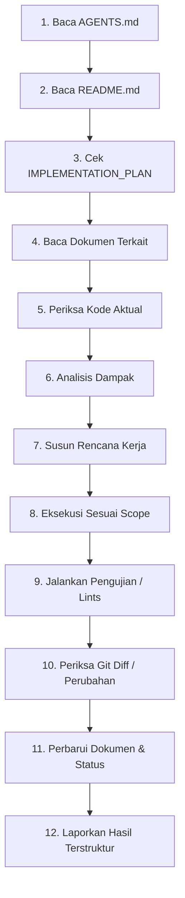

# AI_WORKFLOW — Alur Kerja 12 Langkah AI Agent

Dokumen ini mendefinisikan protokol kerja standar 12 langkah yang wajib dieksekusi secara disiplin oleh setiap AI agent sebelum, selama, dan setelah mengerjakan tugas dalam repositori Wallet App.

---

## 1. Alur Kerja Standar 12 Langkah

1. **Langkah 1: Baca AGENTS.md**  
   Pahami batasan operasional, larangan mutlak, dan standar kualitas proyek sebelum melakukan tindakan apa pun.
2. **Langkah 2: Baca README.md**  
   Ketahui status proyek saat ini, konteks monorepo, dan gambaran umum sistem.
3. **Langkah 3: Periksa IMPLEMENTATION_PLAN.md**  
   Pastikan fase mana yang sedang aktif. Jangan melompat ke fase masa depan tanpa verifikasi fase saat ini.
4. **Langkah 4: Baca Dokumen Spesifikasi Terkait**  
   Buka dokumen desain relevan (misal [DATABASE_DESIGN.md](file:///c:/Users/Ulil%20Arsyad%20Ramadhan/Wallet-app/docs/DATABASE_DESIGN.md) untuk DB, [API_CONTRACT.md](file:///c:/Users/Ulil%20Arsyad%20Ramadhan/Wallet-app/docs/API_CONTRACT.md) untuk endpoint, [AUTH_SECURITY.md](file:///c:/Users/Ulil%20Arsyad%20Ramadhan/Wallet-app/docs/AUTH_SECURITY.md) untuk auth).
5. **Langkah 5: Periksa Kode Aktual di Direktori**  
   Gunakan tool pemeriksa berkas (`list_dir`, `view_file`, `grep_search`) untuk memastikan kondisi nyata kode. Jangan pernah berasumsi berkas atau fungsi sudah tersedia.
6. **Langkah 6: Analisis Dampak (Impact Analysis)**  
   Evaluasi apakah perubahan yang akan dibuat memengaruhi komponen lain, tipe data terbagi (*shared types*), skema database, atau rute frontend.
7. **Langkah 7: Susun Rencana Kerja Ringkas**  
   Tentukan daftar berkas yang akan dibuat atau diubah beserta urutan pengerjaannya sebelum mulai menulis kode.
8. **Langkah 8: Eksekusi Kode Hanya dalam Scope Task**  
   Tulis kode secara terfokus pada cakupan permintaan saat ini. Dilarang melakukan refactor liar pada modul di luar scope tanpa instruksi eksplisit.
9. **Langkah 9: Jalankan Validasi & Pengujian**  
   Jalankan skrip build, linter, unit test, atau integration test untuk membuktikan kebenaran implementasi.
10. **Langkah 10: Periksa Diff & Kebersihan Perubahan**  
    Tinjau kembali file yang dimodifikasi. Pastikan tidak ada dead code, logging kredensial, atau perubahan tak sengaja pada file konfigurasi.
11. **Langkah 11: Perbarui Dokumen & Status Requirement**  
    Jika ada requirement yang selesai atau keputusan baru yang diambil, mutakhirkan [REQUIREMENTS.md](file:///c:/Users/Ulil%20Arsyad%20Ramadhan/Wallet-app/docs/REQUIREMENTS.md) dan [DECISIONS_LOG.md](file:///c:/Users/Ulil%20Arsyad%20Ramadhan/Wallet-app/docs/DECISIONS_LOG.md).
12. **Langkah 12: Laporkan Hasil Secara Terstruktur**  
    Sajikan laporan ringkas: ringkasan perubahan, file yang dibuat/diubah, hasil tes aktual, status requirement terkini, risiko, dan langkah selanjutnya.

---

## 2. Hierarki Sumber Kebenaran (Truth Priority)
Bila timbul pertentangan informasi antar sumber, AI agent wajib mematuhi hierarki berikut:
1. **Prioritas 1: Instruksi & Permintaan Terbaru Pengguna** (terkait cakupan tugas spesifik yang sedang diberikan).
2. **Prioritas 2: Prinsip Keamanan & Integritas Data** (pencegahan kebocoran data, race condition, integritas finansial, saldo non-negatif).
3. **Prioritas 3: Implementasi Aktual yang Terverifikasi** (kode yang ada di repositori dan lulus tes).
4. **Prioritas 4: Kontrak & Spesifikasi yang Disepakati** (`API_CONTRACT.md`, `DATABASE_DESIGN.md`, `ARCHITECTURE.md`).
5. **Prioritas 5: Asumsi Tercatat** (`[ASSUMPTION]` pada dokumentasi).

---

## 3. Aturan Resolusi Konflik
- **Dilarang Menyelesaikan Konflik Secara Diam-Diam**: Jika ditemukan kontradiksi antara instruksi tugas dengan dokumen arsitektur, atau antara dua dokumen spesifikasi, AI agent DILARANG memilih asumsi sendiri tanpa mencatatnya.
- **Pencatatan Eksplisit**: Catat konflik tersebut di [DECISIONS_LOG.md](file:///c:/Users/Ulil%20Arsyad%20Ramadhan/Wallet-app/docs/DECISIONS_LOG.md) dengan status `[OPEN]` atau `proposed`, dan laporkan secara transparan kepada pengguna.
