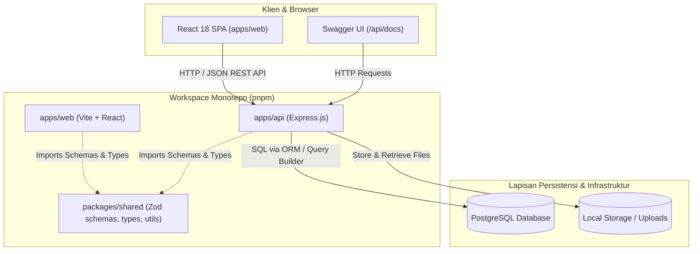
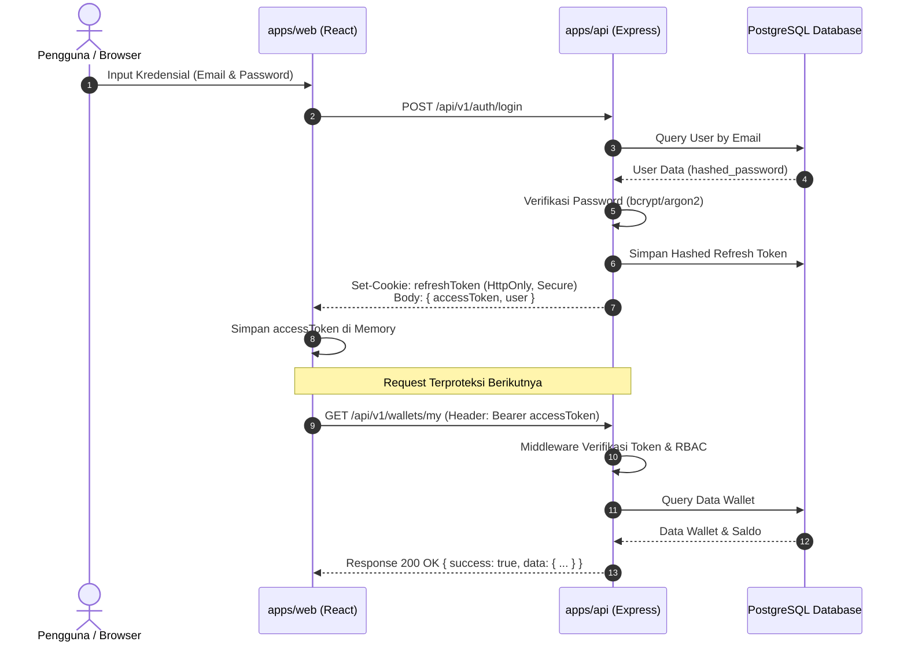
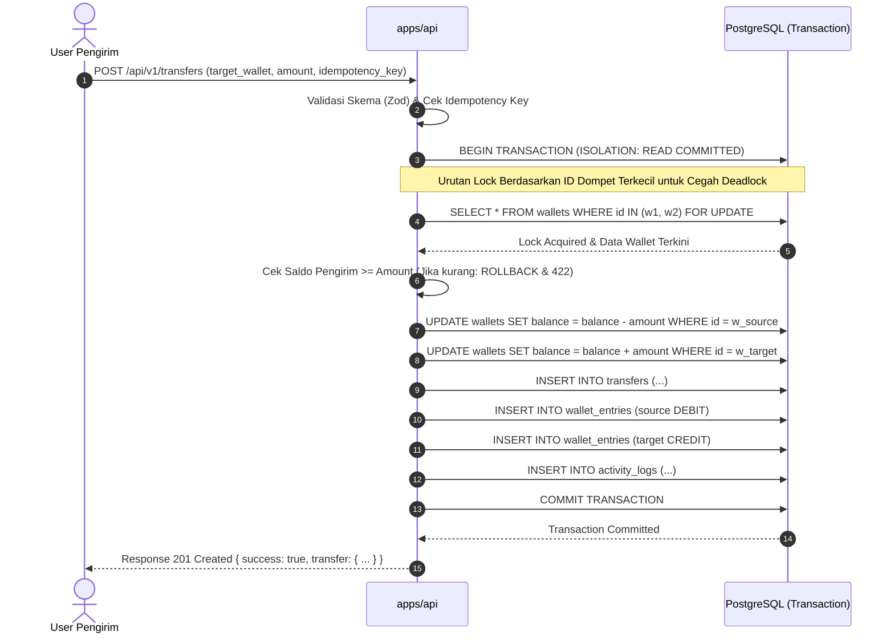

# ARCHITECTURE — Arsitektur Sistem Wallet App

Dokumen ini mendeskripsikan arsitektur monorepo, tanggung jawab lapisan komponen, aliran data kritis, manajemen error, dan diagram alur sistem Wallet App.

---

## 1. Arsitektur Monorepo & Struktur Komponen `[DECIDED]`
Sistem dibangun menggunakan **pnpm workspaces** yang membagi aplikasi ke dalam unit-unit independen namun terintegrasi:



### Tanggung Jawab Komponen
1. **`apps/web`**: Single Page Application (SPA) berbasis React + Vite + Tailwind CSS. Menangani UI/UX, client-side routing, manajemen state server via TanStack Query, dan validasi form interaktif.
2. **`apps/api`**: RESTful Backend API berbasis Node.js + Express + TypeScript. Bertanggung jawab atas autentikasi, otorisasi RBAC, integritas transaksi keuangan, mutasi saldo dompet atomik, dan penyimpanan bukti transaksi.
3. **`packages/shared`**: Pustaka bersama yang memuat kontrak data: Skema validasi Zod (DTO), definisi tipe TypeScript (*types/interfaces*), konstanta enum (Role, TransactionType, EntryType), dan fungsi format mata uang/tanggal.
4. **`infrastructure`**: Skrip orchestrasi Docker Compose untuk dependensi lokal (PostgreSQL) dan konfigurasi containerisasi terkelola.

---

## 2. Tanggung Jawab Lapisan Backend (Layered Architecture) `[DECIDED]`
Backend `apps/api` mengadopsi pola berlapis (*Separation of Concerns*) yang ketat:
```
[ HTTP Request ]
       │
       ▼
[ Middlewares ] ──── (Rate Limit, Helmet, CORS, Body Parser, Auth JWT, RBAC)
       │
       ▼
[ Controllers ] ─── (Parsing DTO, HTTP Status Mapping, Invoking Service)
       │
       ▼
[ Services ] ────── (Pure Business Logic, Transaction Boundary, Validations)
       │
       ▼
[ Repositories ] ── (Database Queries, SQL Construction, Lock Handling)
       │
       ▼
[ PostgreSQL DB ]
```
- **Controller**: DILARANG mengeksekusi query database langsung atau mengandung kalkulasi bisnis. Hanya menerima request, memanggil service, dan mengembalikan HTTP response.
- **Service**: Mengelola aturan bisnis (validasi saldo cukup, verifikasi akun tujuan, membungkus alur dalam unit transaksi database).
- **Repository**: Melakukan operasi I/O data mentah ke database dan memetakan hasil query ke model entitas.

---

## 3. Alur Permintaan & Autentikasi (Request & Auth Flow) `[DECIDED]`



---

## 4. Alur Transaksi Finansial & Transfer Saldo (Atomicity Flow) `[DECIDED]`

Transfer saldo internal antar-dua pengguna adalah operasi paling kritis dalam sistem:



---

## 5. Pengelolaan Environment & Keamanan Konfigurasi `[DECIDED]`
- Seluruh konfigurasi sensitif dimuat melalui variabel lingkungan (`process.env`) yang divalidasi saat startup via skema Zod di `apps/api/src/config/env.ts`.
- Jika ada variabel wajib yang kosong atau formatnya keliru saat server dinyalakan, aplikasi akan **fail-fast** dan menolak *bootstrapping*.
- File `.env` tidak pernah disertakan dalam git (didaftarkan di `.gitignore`), hanya file `.env.example` dengan placeholder deskriptif yang dikomit.

---

## 6. Standar Penanganan Error & Logging `[DECIDED]`
1. **AppError Abstraksi**: Kelas turunan `Error` kustom yang menampung `statusCode`, `errorCode`, dan `isOperational`.
2. **Global Error Middleware**:
   - Menangkap unhandled exception dan AppError.
   - Mengembalikan struktur seragam:
     ```json
     {
       "success": false,
       "error": {
         "code": "INSUFFICIENT_FUNDS",
         "message": "Saldo dompet tidak mencukupi untuk melakukan transfer",
         "details": null
       }
     }
     ```
   - Di lingkungan `production`, pesan error internal (500) disanitasi menjadi pesan generik tanpa kebocoran *stack trace*.
3. **Audit & Logging**: Request dicatat menggunakan format terstruktur (metode HTTP, URL, status code, respon time, user ID jika terautentikasi) tanpa pernah mencatat token, password, atau nomor kartu.
