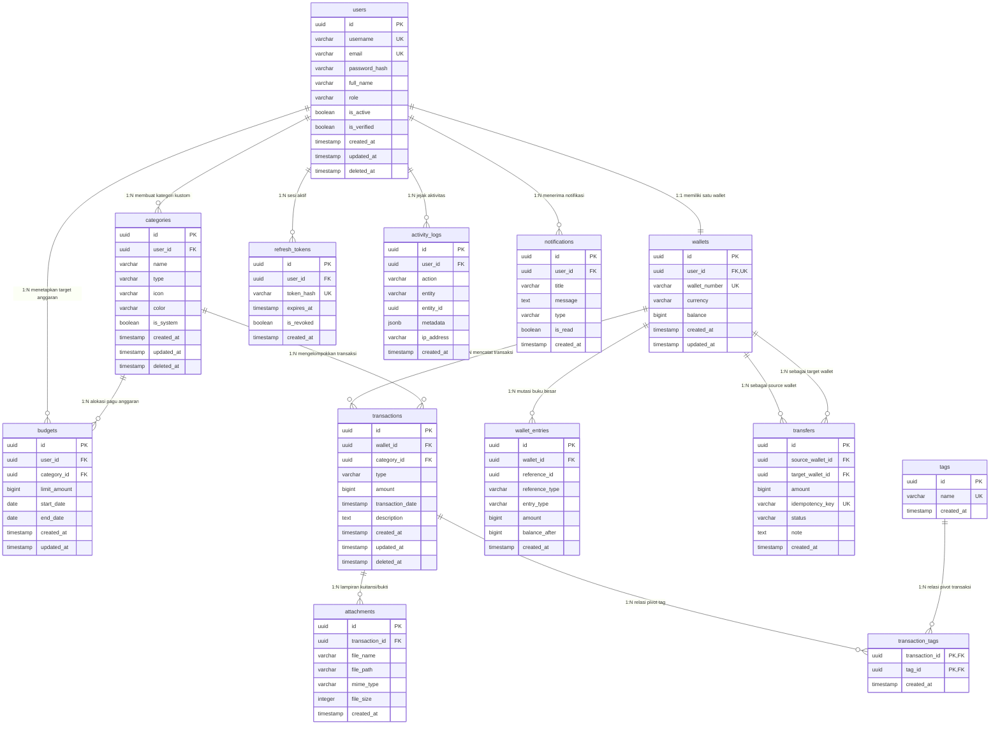

# DATABASE_DESIGN — Desain Skema Database PostgreSQL

Dokumen ini mendefinisikan arsitektur basis data relasional untuk Wallet App: normalisasi $\ge \text{3NF}$, struktur tabel lengkap, tipe relasi, constraint integritas, strategi indexing, soft delete, dan diagram ERD Mermaid.

---

## 1. Diagram Hubungan Entitas (ERD Mermaid) `[DECIDED]`

---

## 2. Rincian 4 Tipe Kardinalitas Relasi Nyata `[DECIDED]`

| Tipe Kardinalitas | Relasi Entitas | Penjelasan Bisnis Nyata | Implementasi Relasional |
| :--- | :--- | :--- | :--- |
| **1:1 (One-to-One)** | `users` $\leftrightarrow$ `wallets` | Setiap pengguna yang mendaftar secara otomatis memiliki tepat 1 akun dompet saldo utama; dompet tersebut hanya dimiliki oleh satu pengguna tersebut. | Foreign key `wallets.user_id` memiliki constraint `UNIQUE NOT NULL` mereferensikan `users.id`. |
| **1:N (One-to-Many)** | `categories` $\leftrightarrow$ `transactions` | Satu kategori (misal: "Makanan & Minuman") dapat digunakan oleh banyak transaksi belanja pengguna; satu transaksi belanja hanya memiliki satu kategori utama. | Foreign key `transactions.category_id` mereferensikan `categories.id`. |
| **N:1 (Many-to-One)** | `wallet_entries` $\leftrightarrow$ `wallets` | Banyak entri mutasi buku besar debit dan kredit mereferensikan satu akun dompet pemilik mutasi. | Foreign key `wallet_entries.wallet_id` mereferensikan `wallets.id`. |
| **N:N (Many-to-Many)** | `transactions` $\leftrightarrow$ `tags` | Satu transaksi belanja dapat memiliki banyak label tag (misal: `#kuliner`, `#weekend`), dan satu tag dapat dilekatkan pada banyak transaksi. | Dihubungkan melalui tabel perantara (*pivot table*) `transaction_tags` dengan composite primary key `(transaction_id, tag_id)`. |

---

## 3. Spesifikasi Rinci Tabel & Kolom `[DECIDED]`

### 1. `users` (Tabel Akun & Identitas)
- `id`: `UUID PRIMARY KEY DEFAULT gen_random_uuid()`
- `username`: `VARCHAR(50) NOT NULL UNIQUE`
- `email`: `VARCHAR(255) NOT NULL UNIQUE`
- `password_hash`: `VARCHAR(255) NOT NULL`
- `full_name`: `VARCHAR(100) NOT NULL`
- `role`: `VARCHAR(20) NOT NULL DEFAULT 'user'` (CHECK: `role IN ('user', 'admin')`)
- `is_active`: `BOOLEAN NOT NULL DEFAULT true`
- `is_verified`: `BOOLEAN NOT NULL DEFAULT true`
- `created_at`: `TIMESTAMPTZ NOT NULL DEFAULT NOW()`
- `updated_at`: `TIMESTAMPTZ NOT NULL DEFAULT NOW()`
- `deleted_at`: `TIMESTAMPTZ NULL` (Soft Delete)
- *Constraint*: Partial Unique Indexes: `UNIQUE (LOWER(email)) WHERE deleted_at IS NULL` dan `UNIQUE (LOWER(username)) WHERE deleted_at IS NULL`

### 2. `wallets` (Tabel Dompet Saldo Internal)
- `id`: `UUID PRIMARY KEY DEFAULT gen_random_uuid()`
- `user_id`: `UUID NOT NULL UNIQUE REFERENCES users(id) ON DELETE CASCADE`
- `wallet_number`: `VARCHAR(32) NOT NULL UNIQUE`
- `currency`: `VARCHAR(3) NOT NULL DEFAULT 'IDR'`
- `balance`: `BIGINT NOT NULL DEFAULT 0 CHECK (balance >= 0)`
- `created_at`: `TIMESTAMPTZ NOT NULL DEFAULT NOW()`
- `updated_at`: `TIMESTAMPTZ NOT NULL DEFAULT NOW()`

### 3. `categories` (Tabel Kategori Transaksi)
- `id`: `UUID PRIMARY KEY DEFAULT gen_random_uuid()`
- `user_id`: `UUID NULL REFERENCES users(id) ON DELETE CASCADE` (NULL untuk sistem default)
- `name`: `VARCHAR(50) NOT NULL`
- `type`: `VARCHAR(20) NOT NULL CHECK (type IN ('income', 'expense'))`
- `icon`: `VARCHAR(50) NOT NULL DEFAULT 'tag'`
- `color`: `VARCHAR(20) NOT NULL DEFAULT '#64748b'`
- `is_system`: `BOOLEAN NOT NULL DEFAULT false`
- `created_at`: `TIMESTAMPTZ NOT NULL DEFAULT NOW()`
- `updated_at`: `TIMESTAMPTZ NOT NULL DEFAULT NOW()`
- `deleted_at`: `TIMESTAMPTZ NULL` (Soft Delete)
- *Constraint*: `UNIQUE (name, user_id, type)`

### 4. `budgets` (Tabel Pagu Anggaran)
- `id`: `UUID PRIMARY KEY DEFAULT gen_random_uuid()`
- `user_id`: `UUID NOT NULL REFERENCES users(id) ON DELETE CASCADE`
- `category_id`: `UUID NOT NULL REFERENCES categories(id) ON DELETE RESTRICT`
- `limit_amount`: `BIGINT NOT NULL CHECK (limit_amount > 0)`
- `start_date`: `DATE NOT NULL`
- `end_date`: `DATE NOT NULL`
- `created_at`: `TIMESTAMPTZ NOT NULL DEFAULT NOW()`
- `updated_at`: `TIMESTAMPTZ NOT NULL DEFAULT NOW()`
- *Constraint*: `CHECK (end_date >= start_date)`

### 5. `transactions` (Tabel Catatan Transaksi Keuangan)
- `id`: `UUID PRIMARY KEY DEFAULT gen_random_uuid()`
- `wallet_id`: `UUID NOT NULL REFERENCES wallets(id) ON DELETE CASCADE`
- `category_id`: `UUID NOT NULL REFERENCES categories(id) ON DELETE RESTRICT`
- `type`: `VARCHAR(20) NOT NULL CHECK (type IN ('income', 'expense'))`
- `amount`: `BIGINT NOT NULL CHECK (amount > 0)`
- `transaction_date`: `TIMESTAMPTZ NOT NULL DEFAULT NOW()`
- `description`: `TEXT NOT NULL DEFAULT ''`
- `created_at`: `TIMESTAMPTZ NOT NULL DEFAULT NOW()`
- `updated_at`: `TIMESTAMPTZ NOT NULL DEFAULT NOW()`
- `deleted_at`: `TIMESTAMPTZ NULL` (Soft Delete)

### 6. `wallet_entries` (Tabel Buku Besar Mutasi Saldo / Immutable Ledger)
- `id`: `UUID PRIMARY KEY DEFAULT gen_random_uuid()`
- `wallet_id`: `UUID NOT NULL REFERENCES wallets(id) ON DELETE CASCADE`
- `reference_id`: `UUID NULL` (ID transaksi atau ID transfer terkait)
- `reference_type`: `VARCHAR(50) NOT NULL` ('transaction', 'transfer_send', 'transfer_receive', 'topup_simulation')
- `entry_type`: `VARCHAR(10) NOT NULL CHECK (entry_type IN ('debit', 'credit'))`
- `amount`: `BIGINT NOT NULL CHECK (amount > 0)`
- `balance_after`: `BIGINT NOT NULL CHECK (balance_after >= 0)`
- `created_at`: `TIMESTAMPTZ NOT NULL DEFAULT NOW()`

### 7. `transfers` (Tabel Rekaman Transfer Saldo Internal)
- `id`: `UUID PRIMARY KEY DEFAULT gen_random_uuid()`
- `source_wallet_id`: `UUID NOT NULL REFERENCES wallets(id) ON DELETE RESTRICT`
- `target_wallet_id`: `UUID NOT NULL REFERENCES wallets(id) ON DELETE RESTRICT`
- `amount`: `BIGINT NOT NULL CHECK (amount > 0)`
- `idempotency_key`: `VARCHAR(64) NOT NULL UNIQUE`
- `status`: `VARCHAR(20) NOT NULL DEFAULT 'completed' CHECK (status IN ('pending', 'completed', 'failed', 'reversed'))`
- `note`: `TEXT NULL`
- `created_at`: `TIMESTAMPTZ NOT NULL DEFAULT NOW()`
- *Constraint*: `CHECK (source_wallet_id <> target_wallet_id)`

### 8. `attachments` (Tabel Lampiran Kuitansi / Bukti Transaksi)
- `id`: `UUID PRIMARY KEY DEFAULT gen_random_uuid()`
- `transaction_id`: `UUID NOT NULL REFERENCES transactions(id) ON DELETE CASCADE`
- `file_name`: `VARCHAR(255) NOT NULL`
- `file_path`: `VARCHAR(500) NOT NULL`
- `mime_type`: `VARCHAR(100) NOT NULL`
- `file_size`: `INTEGER NOT NULL CHECK (file_size > 0 AND file_size <= 2097152)`
- `created_at`: `TIMESTAMPTZ NOT NULL DEFAULT NOW()`

### 9. `tags` & `transaction_tags` (Tabel Taksonomi N:N)
- `tags`:
  - `id`: `UUID PRIMARY KEY DEFAULT gen_random_uuid()`
  - `name`: `VARCHAR(50) NOT NULL UNIQUE`
  - `created_at`: `TIMESTAMPTZ NOT NULL DEFAULT NOW()`
- `transaction_tags`:
  - `transaction_id`: `UUID NOT NULL REFERENCES transactions(id) ON DELETE CASCADE`
  - `tag_id`: `UUID NOT NULL REFERENCES tags(id) ON DELETE CASCADE`
  - `created_at`: `TIMESTAMPTZ NOT NULL DEFAULT NOW()`
  - *Primary Key*: `PRIMARY KEY (transaction_id, tag_id)`

### 10. `refresh_tokens`, `activity_logs`, `notifications` (Tabel Dukungan Sistem)
- `refresh_tokens`: `id`, `user_id` (FK), `token_hash` (UNIQUE), `expires_at`, `is_revoked`, `created_at`.
- `activity_logs`: `id`, `user_id` (FK NULL), `action`, `entity`, `entity_id`, `metadata` (JSONB), `ip_address`, `created_at`.
- `notifications`: `id`, `user_id` (FK), `title`, `message`, `type`, `is_read` (DEFAULT false), `created_at`.

---

## 4. Kebijakan Soft Delete $\ge 2$ Tabel `[DECIDED]`
Soft delete (`deleted_at TIMESTAMP NULL`) diterapkan pada 3 entitas kunci:
1. **`users`**: Menghindari penghapusan akun yang dapat merusak audit trail transfer saldo antar-pengguna. Saat user dinonaktifkan/dihapus, relasi transfer historis tetap valid.
2. **`categories`**: Menghapus kategori tidak boleh menyebabkan error foreign key constraint pada transaksi-transaksi lampau.
3. **`transactions`**: Pengguna dapat membatalkan/menghapus catatan transaksi dari tampilan dashboard pribadi, namun data tetap tersimpan untuk keperluan audit finansial dan penyesuaian ledger jika diperlukan.

---

## 5. Indeks Kinerja & Integritas `[DECIDED]`
- `CREATE INDEX idx_transactions_wallet_date ON transactions(wallet_id, transaction_date DESC) WHERE deleted_at IS NULL;`
- `CREATE INDEX idx_transactions_category ON transactions(category_id) WHERE deleted_at IS NULL;`
- `CREATE INDEX idx_wallet_entries_wallet ON wallet_entries(wallet_id, created_at DESC);`
- `CREATE INDEX idx_transfers_source_target ON transfers(source_wallet_id, target_wallet_id, created_at DESC);`
- `CREATE INDEX idx_budgets_user_period ON budgets(user_id, start_date, end_date);`
- `CREATE INDEX idx_activity_logs_user_created ON activity_logs(user_id, created_at DESC);`
- `CREATE INDEX idx_notifications_user_unread ON notifications(user_id, is_read) WHERE is_read = false;`
- `CREATE INDEX idx_refresh_tokens_family_user_active ON refresh_tokens (family_id, user_id) WHERE is_revoked = false;` (Migration 010: Session Binding Index untuk verifikasi instan status sesi aktif di middleware `authenticate`)

---

## 6. Kebijakan Seeder ($\ge 20$ Data Seed per Tabel Utama) `[DECIDED]`
Untuk memenuhi persyaratan pengujian dan demonstrasi tugas:
- `users`: Minimal 20 akun realistis (1 superadmin `admin@walletapp.local`, 19 regular user aktif).
- `wallets`: Minimal 20 akun dompet (masing-masing terhubung ke salah satu user) dengan saldo awal terdistribusi realistis (Rp 500.000 s/d Rp 25.000.000).
- `categories`: Minimal 20 kategori (10 kategori sistem pengeluaran, 5 kategori sistem pemasukan, 5 kategori kustom user).
- `budgets`: Minimal 20 target anggaran bulanan yang mencakup beragam kategori dan rentang persentase pemakaian.
- `transactions`: Minimal 40 transaksi realistis (pemasukan & pengeluaran) tersebar dalam 3 bulan terakhir.
- `wallet_entries`: Minimal 40 mutasi ledger yang konsisten dengan saldo akhir setiap wallet.
- `transfers`: Minimal 20 transaksi transfer internal antar-pengguna dengan status sukses.
- `tags`: Minimal 20 tag kustom (misal: `#makanan`, `#gajian`, `#tagihan`, `#hobi`, `#kopi`).
- `transaction_tags`: Minimal 20 pemetaan pivot transaksi ke tag.

---

## 7. Perbedaan dari Rancangan Awal (Phase 2 Actual Implementation) `[ACCEPTED]`

Selama implementasi nyata dan pengujian Phase 2, dilakukan penyempurnaan skema yang disengaja berikut demi keamanan dan kepatuhan constraint:
1. **Penambahan Kolom `users.is_verified`**: Ditambahkan dengan tipe `BOOLEAN NOT NULL DEFAULT true` untuk menyelesaikan rekomendasi `OPEN-PB-01` (akun langsung siap digunakan saat registrasi tanpa hambatan OTP/verifikasi email di fase awal).
2. **Partial Unique Indexes untuk Soft Delete & Case-Insensitive**:
   - Pada tabel `users`: alih-alih constraint `UNIQUE` biasa yang akan memblokir email pengguna baru jika ada pengguna lama ber-status soft delete, digunakan Partial Unique Index `UNIQUE (LOWER(email)) WHERE deleted_at IS NULL` dan `UNIQUE (LOWER(username)) WHERE deleted_at IS NULL`.
   - Pada tabel `categories`: dipisahkan menjadi dua partial index:
     - Kategori kustom: `UNIQUE (user_id, LOWER(name), type) WHERE deleted_at IS NULL AND user_id IS NOT NULL`
     - Kategori sistem: `UNIQUE (LOWER(name), type) WHERE deleted_at IS NULL AND user_id IS NULL`
     Hal ini mencegah bentrok saat membuat kategori kustom dengan nama yang sama setelah kategori lama di-soft delete.
3. **Penegakan Database Trigger untuk Append-Only Ledger (`wallet_entries`)**:
   - Dibuat fungsi trigger PostgreSQL `prevent_wallet_entries_mutation()` dan disematkan pada `wallet_entries` (`BEFORE UPDATE` dan `BEFORE DELETE`) untuk menjamin secara absolut bahwa baris mutasi buku besar tidak dapat diubah atau dihapus oleh siapapun.
4. **Trigger Otomatisasi `updated_at`**:
   - Fungsi PostgreSQL `set_updated_at_timestamp()` dipasang pada seluruh tabel yang memuat `updated_at` (`users`, `wallets`, `categories`, `budgets`, `transactions`) agar timestamp selalu terbarui secara atomik di tingkat database.
5. **Constraint Eksplisit Bernama pada `budgets` dan `transfers`**:
   - `budgets`: ditambahkan `CONSTRAINT uq_budgets_user_category_period UNIQUE (user_id, category_id, start_date, end_date)`.
   - `transfers`: ditambahkan `CONSTRAINT chk_transfers_different_wallets CHECK (source_wallet_id <> target_wallet_id)`.

---

## 8. Penyempurnaan Skema Phase 5 (`011_phase5_core_financial_schema`) `[ACCEPTED]`

Migrasi `011_phase5_core_financial_schema` memperkuat integritas data dan idempotensi transaksi:
1. **Atribut Dompet Tambahan (`wallets`)**:
   - `name VARCHAR(50) NOT NULL DEFAULT 'Dompet Utama'`: Mendukung penamaan akun dompet.
   - `is_active BOOLEAN NOT NULL DEFAULT true`: Memungkinkan penonaktifan dompet secara terisolasi.
2. **State Machine Transaksi (`transactions.status`)**:
   - Menambahkan kolom `status VARCHAR(20) NOT NULL DEFAULT 'COMPLETED'`.
   - Constraint: `CHECK (status IN ('COMPLETED', 'VOIDED'))`.
   - Indeks parsial: `CREATE INDEX idx_transactions_wallet_status_date ON transactions(wallet_id, status, transaction_date DESC) WHERE deleted_at IS NULL;`
3. **Ekspansi Reference Type Ledger (`wallet_entries`)**:
   - Memperluas nilai valid `reference_type` mencakup `'transaction_void'` dan `'reversal'`.
4. **Scoped Idempotency Constraint pada `transfers`**:
   - Mengganti constraint global `UNIQUE(idempotency_key)` menjadi compound unique: `CONSTRAINT uq_transfers_source_idempotency_key UNIQUE (source_wallet_id, idempotency_key)`. Memungkinkan pengguna berbeda secara independen menggunakan key yang sama tanpa bentrok lintas-pengguna.
5. **Tabel Cache Idempotensi Terdedikasi (`idempotency_records`)**:
   - `id`: `UUID PRIMARY KEY DEFAULT gen_random_uuid()`
   - `user_id`: `UUID NOT NULL REFERENCES users(id) ON DELETE CASCADE`
   - `idempotency_key`: `VARCHAR(128) NOT NULL`
   - `request_hash`: `VARCHAR(64) NOT NULL` (SHA-256 dari canonical request body)
   - `response_status`: `INTEGER NOT NULL`
   - `response_body`: `JSONB NOT NULL`
   - `created_at`: `TIMESTAMPTZ NOT NULL DEFAULT NOW()`
   - Constraint: `CONSTRAINT uq_idempotency_user_key UNIQUE (user_id, idempotency_key)`
   - Indeks: `CREATE INDEX idx_idempotency_created_at ON idempotency_records(created_at);`

