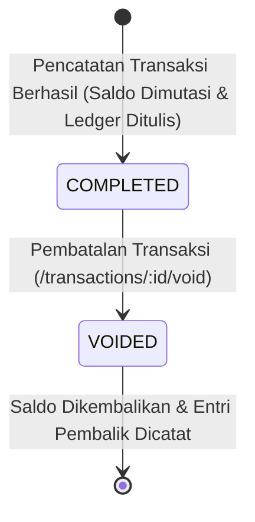
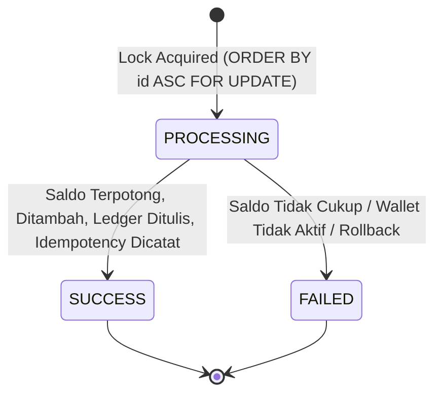

# DOMAIN_MODEL — Model Domain & Analisis Trade-off Finansial

Dokumen ini mendefinisikan entitas domain inti, relasi konseptual, state machine, dan analisis mendalam terhadap trade-off arsitektur data finansial untuk Wallet App.

---

## 1. Definisi Entitas Domain Inti
1. **User**: Entitas pemilik identitas dalam sistem. Memiliki kredensial autentikasi, profil (nama, email, username), dan peran (`role`: 'user' atau 'admin').
2. **Wallet**: Entitas akun keuangan virtual tertutup (*closed-loop*). Setiap pengguna memiliki tepat satu dompet utama (relasi 1:1) yang memuat snapshot saldo terverifikasi (`balance`).
3. **Transaction**: Catatan mutasi keuangan pengguna untuk pemasukan (*income*) atau pengeluaran (*expense*), terkait dengan kategori tertentu dan dapat memiliki lampiran bukti transfer.
4. **WalletEntry (Ledger Entry)**: Catatan pembukuan buku besar atomik (*double-entry principle*) yang merekam debit atau kredit mutasi saldo wallet.
5. **Transfer**: Entitas transaksi khusus yang memindahkan saldo dari dompet pengirim (*source wallet*) ke dompet penerima (*target wallet*) dalam transaksi atomik.
6. **Category**: Klasifikasi jenis transaksi (misalnya Makanan & Minuman, Transportasi, Gaji, Investasi). Dapat berupa kategori default sistem (global) atau kategori kustom pengguna.
7. **Budget**: Batasan pagu pengeluaran terencana per kategori dalam suatu periode (bulanan) yang memantau akumulasi pengeluaran.
8. **Attachment**: Metadata berkas bukti transaksi (struk/faktur) yang diunggah pengguna.
9. **ActivityLog**: Jejak audit sistem *append-only* yang mencatat operasi kritis terstandarisasi sesuai katalog `ACTIVITY_ACTIONS` (autentikasi, mutasi/metadata dompet, transaksi, transfer saldo, kategori, anggaran, dan lampiran).
10. **Notification**: Pemberitahuan aplikasi kepada pengguna (misal: transfer masuk, peringatan pagu anggaran terlampaui $\ge 80\%$).
11. **Tag & TransactionTag**: Label taksonomi fleksibel yang dapat dilekatkan pada banyak transaksi (relasi N:N).

---

## 2. Analisis Trade-off & Keputusan Kritis Finansial

### A. Representasi Nilai Uang (Integer Minor Unit vs NUMERIC) `[DECIDED]`
- **Opsi 1: `FLOAT` / `DOUBLE` di Database & JavaScript Number**:
  - *Kelemahan*: Binary floating point menghasilkan presisi tidak tepat (misal `0.1 + 0.2 = 0.30000000000000004`). Tidak dapat ditoleransi dalam sistem keuangan.
- **Opsi 2: `NUMERIC(15, 2)` / `DECIMAL`**:
  - *Kelebihan*: Standar database finansial umum yang mendukung sen.
  - *Kelemahan*: Di JavaScript, nilai numerik floating point tetap dapat terdistorsi saat di-parse menjadi `number`, membutuhkan pustaka bignumber tambahan.
- **Opsi 3: Integer Minor Units (`BIGINT` di DB / Integer Rupiah Utuh)**:
  - *Kelebihan*: IDR (Rupiah) dalam praktik operasional tidak menggunakan sen/desimal pecahan. Nilai 1 Rupiah direpresentasikan sebagai integer `1`. Untuk mata uang dengan sen di masa depan, minor unit sen (misal 100 sen = 1 dolar) tetap berupa integer. Operasi penambahan/pengurangan integer pada JavaScript dan SQL 100% presisi tanpa floating point artifact.
- **Keputusan**: **Menggunakan Integer Minor Units (`BIGINT` di PostgreSQL / Integer di backend) dengan basis mata uang IDR**. Lapisan frontend memformat angka murni untuk kebutuhan tampilan menggunakan `Intl.NumberFormat('id-ID')`.

---

### B. Arsitektur Saldo: Kolom Turunan vs Dihitung dari Ledger (`wallet_entries`) `[DECIDED]`
- **Opsi 1: Pure Computed Balance (Dihitung dari `SUM(amount)` tabel ledger setiap kali query)**:
  - *Kelebihan*: Tidak ada anomali duplikasi nilai.
  - *Kelemahan*: Skalabilitas buruk. Menghitung agregat seluruh riwayat transaksi setiap kali user membuka dashboard atau melakukan transfer akan memperlambat response time seiring bertambahnya volume data.
- **Opsi 2: Pure Snapshot Balance (Hanya kolom `balance` di tabel `wallets` tanpa ledger)**:
  - *Kelebihan*: Sangat cepat saat query baca.
  - *Kelemahan*: Rentan hilang jejak audit. Jika terjadi anomali sistem atau bug, tidak ada rekaman forensik untuk membuktikan dari mana selisih angka berasal.
- **Opsi 3: Hybrid Snapshot + Immutable Double-Entry Ledger (`wallet_entries`)**:
  - *Kelebihan*: Kolom `wallets.balance` menyimpan saldo terkini terverifikasi untuk performa tinggi read query. Setiap perubahan `balance` WAJIB disertai penulisan baris baru pada tabel `wallet_entries` (debit/kredit) dalam transaksi atomik yang sama. Konsistensi dapat diverifikasi kapan saja dengan query audit rekonsiliasi: `SUM(credits) - SUM(debits) == wallets.balance`.
- **Keputusan**: **Mengadopsi Pola Hybrid (Snapshot `wallets.balance` + Immutable `wallet_entries`)**.

---

### C. Atomisitas Transfer Saldo & Pencegahan Deadlock `[DECIDED]`
Pada operasi transfer saldo internal dari Pengguna A ke Pengguna B:
1. **Risiko Concurrency**:
   - *Lost Update*: Pengguna A mentransfer secara bersamaan di dua tab browser; saldo terpotong hanya sekali jika tidak ada lock.
   - *Deadlock*: Pengguna A mentransfer ke Pengguna B pada saat bersamaan Pengguna B mentransfer ke Pengguna A. Jika A mengunci row A lalu meminta row B, sementara B mengunci row B lalu meminta row A, database akan mengalami deadlock.
2. **Strategi Locking Terurut (Sorted Locking Order)**:
   - Sebelum melakukan update, transaksi database mengambil *exclusive row lock* (`SELECT ... FOR UPDATE`) pada kedua dompet.
   - Kedua baris dompet dikunci secara terurut berdasarkan ID terkecil terlebih dahulu:
     ```sql
     -- Jika wallet_source = 5 dan wallet_target = 2:
     -- Urutan lock: ID 2 dulu, baru ID 5
     SELECT id, balance FROM wallets WHERE id IN ($1, $2) ORDER BY id ASC FOR UPDATE;
     ```
   - Karena semua transaksi sistem selalu mengunci dengan urutan ID yang sama (ASC), kondisi *circular wait* tereliminasi sepenuhnya, sehingga **deadlock mustahil terjadi**.
3. **Pengecekan Saldo di dalam Transaction Boundary**:
   - Setelah lock diperoleh, sistem memeriksa: `source_wallet.balance >= transfer_amount`.
   - Jika kurang, transaksi langsung di-ROLLBACK dan mengembalikan HTTP 422 Unprocessable Entity.

---

### D. Idempotensi Permintaan Transfer (Idempotency Key & Canonical Hashing) `[DECIDED]`
- Pengguna yang mengalami latensi jaringan dapat mengirimkan request `POST /api/v1/transfers` berulang kali.
- Klien wajib menyertakan header `Idempotency-Key` (UUIDv4).
- Idempotensi diproteksi di tabel terdedikasi `idempotency_records` dengan `UNIQUE (user_id, idempotency_key)`:
  - Backend menghitung canonical SHA-256 hash dari payload JSON request (`canonicalStringify`).
  - Jika request pertama berhasil, status HTTP dan response body dicatat secara atomik di dalam transaksi transfer yang sama.
  - Jika request ulang dikirim dengan key yang sama dan payload identik: sistem langsung mengembalikan cached response tanpa memotong saldo berulang.
  - Jika key yang sama digunakan dengan payload berbeda: backend menolak dengan error `409 IDEMPOTENCY_CONFLICT`.
- Di tabel `transfers`, kolom `idempotency_key` dijamin unik per dompet sumber via constraint `UNIQUE (source_wallet_id, idempotency_key)`.

---

### E. Kebijakan Saldo Negatif & Safe Arithmetic `[DECIDED]`
- **Aturan Tegas**: Saldo dompet dalam ekosistem Wallet App **TIDAK BOLEH PERNAH BERNILAI NEGATIF** (`balance >= 0`).
- **Penegakan Multilapis**:
  1. *Database Constraint*: `CONSTRAINT chk_wallet_balance_non_negative CHECK (balance >= 0)`.
  2. *Row Lock Check*: Validasi eksplisit di service layer di bawah exclusive row lock (`SELECT ... FOR UPDATE`).
  3. *Safe BigInt Arithmetic*: Operasi penambahan dan pengurangan menggunakan utilitas `safeAddMoney` dan `safeSubtractMoney` di `packages/shared/src/finance.ts` untuk mencegah floating point artifacts dan runtime overflow.

---

### F. Integritas Ledger & Mutasi Saldo Atomik `[DECIDED]`
- **Single Point of Balance Mutation**: Mutasi `wallets.balance` secara ketat hanya diizinkan melalui `WalletsRepository` (`executeBalanceMutation`) di dalam transaksi database atomik.
- **Setiap Mutasi Bersifat Berpasangan dengan Ledger**:
  - Transaksi `INCOME`: 1 entry `CREDIT` pada `wallet_entries`.
  - Transaksi `EXPENSE`: 1 entry `DEBIT` pada `wallet_entries`.
  - Transfer internal: 2 entries berpasangan (1 `DEBIT` pada dompet pengirim, 1 `CREDIT` pada dompet penerima) dengan `reference_type = 'transfer'`.
  - Void transaksi: 1 entry kompensasi (`DEBIT` pembalik untuk INCOME, `CREDIT` pembalik untuk EXPENSE) dengan `reference_type = 'transaction_void'`.
- **Konservasi Saldo Total**: Total debit transfer internal selalu identik dengan total kredit transfer internal ($\sum \text{debit} = \sum \text{credit}$).

---

### G. Model Masuknya Uang pada Ekosistem Tertutup (Closed-Loop Simulation) `[DECIDED]`
- Sistem ini dirancang sebagai **simulasi dompet tertutup (closed-loop wallet)** tanpa ketergantungan pada payment gateway pihak ketiga eksternal (sesuai batasan proyek pada [AGENTS.md](file:///c:/Users/Ulil%20Arsyad%20Ramadhan/Wallet-app/AGENTS.md)).
- Saldo pengguna dalam simulasi ini dapat bertambah ke dalam ekosistem hanya melalui 2 (dua) mekanisme terkontrol:
  1. **Simulasi Top-Up (`POST /api/v1/wallets/my/topup`)**:
     - Ditujukan khusus untuk kebutuhan simulasi pengisian saldo pada fase pengembangan dan pengujian (*testing/development*).
     - **Gating Keamanan Ketat**: Endpoint ini hanya aktif jika flag environment `ENABLE_TOPUP_SIMULATION=true`. Secara bawaan (*default*), flag bernilai `false`. Backend secara otomatis menolak start atau memblokir akses (HTTP 403 `TOPUP_SIMULATION_DISABLED`) apabila `NODE_ENV=production`.
     - **Batas Maksimum Nominal**: Dibatasi oleh pagu batas atas per transaksi yang dikonfigurasi melalui `TOPUP_MAX_AMOUNT_PER_TX` (default Rp 50.000.000) dengan kode error HTTP 400 `LIMIT_EXCEEDED` jika terlampaui.
     - **Pencatatan & Audit**: Setiap simulasi topup dicatat sebagai entri kredit pada `wallet_entries` (`reference_type = 'topup_simulation'`) dan diaudit di `activity_logs`.
  2. **Pencatatan Transaksi Pemasukan Pribadi (`POST /api/v1/transactions` dengan `type: 'income'`)**:
     - Mengakomodasi pencatatan arus kas masuk pengguna (seperti penerimaan gaji tunai, hasil usaha, atau dividen) ke dalam saldo dompet.
     - **Batas Maksimum Nominal**: Dibatasi oleh pagu batas atas per transaksi yang dikonfigurasi melalui `INCOME_MAX_AMOUNT_PER_TX` (default Rp 50.000.000) dengan kode error HTTP 400 `LIMIT_EXCEEDED` jika terlampaui.
     - **Pencatatan & Audit**: Menghasilkan baris mutasi kredit ledger `wallet_entries` berpasangan dengan rekaman transaksi berstatus `COMPLETED`.

---

## 3. State Machine Transaksi & Transfer `[DECIDED]`

### A. State Machine Transaksi (Income / Expense)


- **COMPLETED**: Transaksi aktif. Atribut finansial (`amount`, `type`, `wallet_id`) bersifat kekal (*immutable*). Hanya `notes` dan `category_id` yang dapat diperbarui.
- **VOIDED**: Transaksi dibatalkan secara permanen. Transaksi yang sudah dibatalkan tidak dapat di-void ulang (menghasilkan `400 BAD_REQUEST`).

### B. State Machine Transfer Saldo


---

## 4. Kepemilikan Data & Batasan Hak Akses (Data Ownership) `[DECIDED]`
- Setiap entitas finansial (`wallets`, `transactions`, `budgets`, `categories` kustom) terikat secara kaku pada `user_id`.
- Regular user hanya dapat membaca, mengubah, atau menghapus data miliknya sendiri (`WHERE user_id = :currentUser.id`).
- Admin memiliki hak inspeksi global untuk pemantauan sistem, namun tidak dapat memanipulasi mutasi saldo pengguna tanpa melalui alur resmi yang tercatat di audit trail `activity_logs`.

---

## 5. Model Domain & Integritas Phase 6 (Categories, Budgets, Attachments, Audit Logs) `[DECIDED]`

### A. Kategori Transaksi & Proteksi Kategori Sistem
1. **Pemisahan Kategori Sistem vs Kustom**:
   - Kategori sistem (`is_system = true`, `user_id = NULL`) bersifat global dan dapat dibaca oleh seluruh pengguna.
   - Kategori kustom (`is_system = false`, `user_id = <UUID>`) dimiliki eksklusif oleh pembuatnya.
   - Kategori sistem diproteksi secara absolut: pengguna biasa maupun admin dilarang memodifikasi atau menghapusnya melalui API (`403 FORBIDDEN` / `SYSTEM_CATEGORY_PROTECTED`).
2. **Kesesuaian Tipe Transaksi (`type`)**:
   - Kategori berstatus `income` hanya dapat ditautkan ke transaksi bertipe `INCOME`.
   - Kategori berstatus `expense` hanya dapat ditautkan ke transaksi bertipe `EXPENSE`.
   - Transaksi yang mencoba menggunakan kategori yang tidak sesuai tipenya ditolak dengan HTTP 400 `CATEGORY_TYPE_MISMATCH`.
3. **Mekanisme Reaktivasi Soft-Delete (Name Reuse)**:
   - Jika pengguna membuat kategori kustom baru dengan nama dan tipe yang identik dengan kategori miliknya yang sebelumnya telah di-soft-delete, sistem secara otomatis mereaktivasi kategori lama (`deleted_at = NULL`) dan memperbarui atribut visualnya (`icon`, `color`) tanpa melanggar partial unique index.

### B. Realisasi Anggaran Bebas Floating-Point & Zona Waktu
1. **Aritmatika Basis Points (Basis Points / bps)**:
   - Menghitung persentase realisasi anggaran `spent_amount / limit_amount` menggunakan floating-point rentan pembulatan biner tidak konsisten.
   - Seluruh realisasi anggaran dihitung menggunakan aritmatika integer BigInt murni:
     $$\text{percentage\_bps} = \left\lfloor \frac{\text{spent\_amount} \times 10000}{\text{limit\_amount}} \right\rfloor$$
     Di mana $10000\text{ bps} = 100.00\%$.
   - Kolom `percentage` di lapisan API diformat sebagai desimal terstandarisasi $(\text{bps} / 100)$ dengan 2 digit presisi, dan `is_exceeded` aktif saat $\text{spent\_amount} > \text{limit\_amount}$.
2. **Batas Zona Waktu Terkonfigurasi (`BUDGET_TIMEZONE`) & Interval Setengah Terbuka**:
   - Realisasi belanja mencakup transaksi pengeluaran aktif (`type = 'expense'`, `status = 'COMPLETED'`, dan `deleted_at IS NULL`) menggunakan parameter zona waktu IANA dari konfigurasi `env.BUDGET_TIMEZONE` (default `'Asia/Jakarta'`) melalui ekspresi PostgreSQL `AT TIME ZONE` (bukan offset `+07` yang di-*hardcode*) dan interval setengah terbuka (*half-open interval*) $[\text{start\_date}, \text{end\_date} + 1\text{ hari})$:
     $$\text{transaction\_date} \ge (\text{start\_date}::\text{timestamp AT TIME ZONE } tz) \quad \text{AND} \quad \text{transaction\_date} < ((\text{end\_date} + 1)::\text{timestamp AT TIME ZONE } tz)$$
   - Dengan interval setengah terbuka ini, seluruh transaksi hingga mikrodetik terakhir pada `end_date` (misal `23:59:59.9995`) tetap terhitung tanpa celah pembulatan milidetik `.999`, sementara transaksi tepat pada `00:00:00` hari berikutnya tidak ikut terhitung.
3. **Pencegahan Tumpang Tindih Anggaran**:
   - Pengguna dilarang memiliki dua anggaran aktif untuk kategori yang sama pada rentang periode yang saling tumpang tindih (`409 BUDGET_PERIOD_OVERLAP`).
   - Anggaran mendukung soft-delete (`deleted_at TIMESTAMPTZ NULL`) sehingga histori anggaran lampau tetap terarsip aman.

### C. Lampiran Bukti Transaksi (Proof of Transaction) & Kuota Konkuren
1. **Validasi Integritas Magic Bytes**:
   - Header HTTP `Content-Type` dan ekstensi berkas yang dikirim klien dapat dipalsukan (*MIME spoofing*).
   - Backend memverifikasi byte pembuka (*magic bytes*) buffer berkas secara deterministik untuk tipe MIME yang didukung (`image/jpeg`, `image/png`, `image/webp`, `application/pdf`).
2. **Batas Kuota 5 Lampiran per Transaksi via Row Locking**:
   - Untuk mencegah serangan DoS atau pengisian storage liar, setiap transaksi dibatasi maksimal 5 berkas lampiran aktif.
   - Kuota ditegakkan melalui transaksi database dengan mengunci baris transaksi (`SELECT ... FOR UPDATE`), memeriksa `COUNT(attachments)`, dan menolak penambahan jika kuota penuh (`400 ATTACHMENT_LIMIT_EXCEEDED`).
3. **Rollback Otomatis Berkas Fisik**:
   - Jika operasi database gagal atau di-rollback pasca penyimpanan file ke disk, mekanisme kegagalan secara otomatis menghapus (*unlink*) berkas fisik dari filesystem untuk mencegah berkas yatim (*orphan files*).

### D. Jejak Audit Abadi (Tamper-Proof Immutable Audit Trail)
1. **Immutabilitas Tingkat Database**:
   - Tabel `activity_logs` diproteksi oleh PostgreSQL trigger `trg_activity_logs_immutable`.
   - Setiap perintah `UPDATE` atau `DELETE` pada tabel ini ditolak langsung oleh basis data, menjamin audit trail bersifat *append-only* dan tidak dapat diubah oleh siapapun termasuk admin aplikasi.
2. **Sanitasi & Standarisasi Metadata Audit**:
   - Seluruh payload metadata yang dicatat di `activity_logs` disaring secara ketat oleh `sanitizeLogMetadata`: kata sandi, token autentikasi, hash, secret, buffer, cookie, header otorisasi, `email` mentah, dan `file_path` internal tidak pernah dicatat.
   - Nilai moneter di dalam `metadata` wajib menggunakan kunci `snake_case` seragam (`amount`, `new_balance`, `limit_amount`) dan dikonversi sebagai integer `number` aman lewat `toSafeMoneyNumber`.
3. **Katalog Aksi Terpadu (`ACTIVITY_ACTIONS` — 25 Aksi) & Privasi Login Gagal**:
   - Katalog `ACTIVITY_ACTIONS` (`apps/api/src/shared/logging/activity-log.helper.ts`) menyatukan seluruh 25 konstanta aksi kanonik (satu nama per peristiwa) dan menegakkan union type `ActivityAction` pada `recordActivity` serta `authRepository.recordActivityLog` sehingga literal di luar katalog gagal kompilasi:
     - *Authentication (10)*: `USER_REGISTERED`, `USER_LOGIN`, `USER_LOGIN_FAILED`, `TOKEN_REFRESHED`, `TOKEN_REUSE_DETECTED`, `USER_LOGOUT`, `USER_LOGOUT_ALL`, `PASSWORD_CHANGED`, `PASSWORD_RESET_REQUESTED`, `PASSWORD_RESET_COMPLETED`.
     - *Wallets (2)*: `TOPUP_SIMULATION`, `WALLET_UPDATE`.
     - *Transfers (2)*: `TRANSFER_SENT`, `TRANSFER_RECEIVED`.
     - *Transactions (3)*: `TRANSACTION_CREATED`, `TRANSACTION_METADATA_UPDATED`, `TRANSACTION_VOIDED`.
     - *Categories (3)*: `CATEGORY_CREATED`, `CATEGORY_UPDATED`, `CATEGORY_DELETED`.
     - *Budgets (3)*: `BUDGET_CREATED`, `BUDGET_UPDATED`, `BUDGET_DELETED`.
     - *Attachments (2)*: `ATTACHMENT_UPLOADED`, `ATTACHMENT_DELETED`.
   - **Privasi & Perlindungan Append-Only pada Login Gagal**:
     - Email tidak terdaftar: hanya dicatat ke structured logger aplikasi (`logger.warn`, **bukan** tabel `activity_logs`) dengan hash SHA-256 dari email ternormalisasi (`email_hash`) dan alamat IP (`reason: 'UNREGISTERED_EMAIL'`).
     - Kata sandi salah pada akun aktif yang ada: ditulis ke `activity_logs` sebagai `USER_LOGIN_FAILED` dengan `user_id`, IP, dan `metadata: { reason: 'INVALID_CREDENTIALS' }` tanpa email mentah.
     - Akun nonaktif (`is_active = false`) atau soft-deleted (`deleted_at IS NOT NULL`) yang ada: ditulis ke `activity_logs` sebagai `USER_LOGIN_FAILED` dengan `user_id`, IP, dan `metadata: { reason: 'ACCOUNT_INACTIVE' }` tanpa email mentah.
4. **Batasan Retensi Log (`activity_logs`)**:
   - Karena `trg_activity_logs_immutable` memblokir `DELETE` demi keutuhan jejak audit, tabel `activity_logs` tumbuh secara *append-only* dan belum memiliki mekanisme pemangkasan/pengarsipan partisi otomatis (*automated log retention/archival*); hal ini dicatat secara eksplisit sebagai batasan arsitektural di `ADR-059` dan `[OPEN-SEC-06]`.

