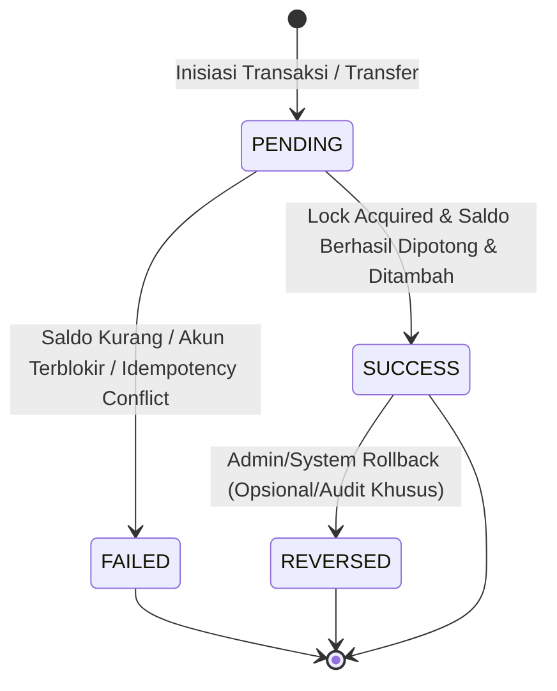

# DOMAIN_MODEL — Model Domain & Analisis Trade-off Finansial

Dokumen ini mendefinisikan entitas domain inti, relasi konseptual, state machine, dan analisis mendalam terhadap trade-off arsitektur data finansial untuk Wallet App.

---

## 1. Definisi Entitas Domain Inti
1. **User**: Entitas pemilik identitas dalam sistem. Memiliki kredensial autentikasi, profil (nama, email, username), dan peran (`role`: 'user' atau 'admin').
2. **Wallet**: Entitas akun keuangan virtual tertutup (*closed-loop*). Setiap pengguna memiliki tepat satu dompet utama (relasi 1:1) yang memuat snapshot saldo terverifikasi (`balance`).
3. **Transaction**: Catatan mutasi keuangan pengguna untuk pemasukan (*income*) atau pengeluaran (*expense*), terkait dengan kategori tertentu dan dapat memiliki lampiran bukti transfer.
4. **WalletEntry (Ledger Entry)**: Catatan pembukuan buku besar atomik (*double-entry principle*) yang merekam debit atau kredit mutasi saldo wallet.
5. **Transfer**: Entitas transaksi khusus yang memindahkan saldo dari dompet pengirim (*source wallet*) ke dompet penerima (*target wallet*) dalam transaksi atomik.
6. **Category**: Klasifikasi jenis transaksi (misalnya Makanan & Minuman, Transportasi, Gaji, Investasi). Dapat berupa kategori default sistem (global) atau kategori kustom pengguna.
7. **Budget**: Batasan pagu pengeluaran terencana per kategori dalam suatu periode (bulanan) yang memantau akumulasi pengeluaran.
8. **Attachment**: Metadata berkas bukti transaksi (struk/faktur) yang diunggah pengguna.
9. **ActivityLog**: Jejak audit sistem yang mencatat operasi kritis (login, perubahan profil, transfer saldo, perubahan status user).
10. **Notification**: Pemberitahuan aplikasi kepada pengguna (misal: transfer masuk, peringatan pagu anggaran terlampaui $\ge 80\%$).
11. **Tag & TransactionTag**: Label taksonomi fleksibel yang dapat dilekatkan pada banyak transaksi (relasi N:N).

---

## 2. Analisis Trade-off & Keputusan Kritis Finansial

### A. Representasi Nilai Uang (Integer Minor Unit vs NUMERIC) `[DECIDED]`
- **Opsi 1: `FLOAT` / `DOUBLE` di Database & JavaScript Number**:
  - *Kelemahan*: Binary floating point menghasilkan presisi tidak tepat (misal `0.1 + 0.2 = 0.30000000000000004`). Tidak dapat ditoleransi dalam sistem keuangan.
- **Opsi 2: `NUMERIC(15, 2)` / `DECIMAL`**:
  - *Kelebihan*: Standar database finansial umum yang mendukung sen.
  - *Kelemahan*: Di JavaScript, nilai numerik floating point tetap dapat terdistorsi saat di-parse menjadi `number`, membutuhkan pustaka bignumber tambahan.
- **Opsi 3: Integer Minor Units (`BIGINT` di DB / Integer Rupiah Utuh)**:
  - *Kelebihan*: IDR (Rupiah) dalam praktik operasional tidak menggunakan sen/desimal pecahan. Nilai 1 Rupiah direpresentasikan sebagai integer `1`. Untuk mata uang dengan sen di masa depan, minor unit sen (misal 100 sen = 1 dolar) tetap berupa integer. Operasi penambahan/pengurangan integer pada JavaScript dan SQL 100% presisi tanpa floating point artifact.
- **Keputusan**: **Menggunakan Integer Minor Units (`BIGINT` di PostgreSQL / Integer di backend) dengan basis mata uang IDR**. Lapisan frontend memformat angka murni untuk kebutuhan tampilan menggunakan `Intl.NumberFormat('id-ID')`.

---

### B. Arsitektur Saldo: Kolom Turunan vs Dihitung dari Ledger (`wallet_entries`) `[DECIDED]`
- **Opsi 1: Pure Computed Balance (Dihitung dari `SUM(amount)` tabel ledger setiap kali query)**:
  - *Kelebihan*: Tidak ada anomali duplikasi nilai.
  - *Kelemahan*: Skalabilitas buruk. Menghitung agregat seluruh riwayat transaksi setiap kali user membuka dashboard atau melakukan transfer akan memperlambat response time seiring bertambahnya volume data.
- **Opsi 2: Pure Snapshot Balance (Hanya kolom `balance` di tabel `wallets` tanpa ledger)**:
  - *Kelebihan*: Sangat cepat saat query baca.
  - *Kelemahan*: Rentan hilang jejak audit. Jika terjadi anomali sistem atau bug, tidak ada rekaman forensik untuk membuktikan dari mana selisih angka berasal.
- **Opsi 3: Hybrid Snapshot + Immutable Double-Entry Ledger (`wallet_entries`)**:
  - *Kelebihan*: Kolom `wallets.balance` menyimpan saldo terkini terverifikasi untuk performa tinggi read query. Setiap perubahan `balance` WAJIB disertai penulisan baris baru pada tabel `wallet_entries` (debit/kredit) dalam transaksi atomik yang sama. Konsistensi dapat diverifikasi kapan saja dengan query audit rekonsiliasi: `SUM(credits) - SUM(debits) == wallets.balance`.
- **Keputusan**: **Mengadopsi Pola Hybrid (Snapshot `wallets.balance` + Immutable `wallet_entries`)**.

---

### C. Atomisitas Transfer Saldo & Pencegahan Deadlock `[DECIDED]`
Pada operasi transfer saldo internal dari Pengguna A ke Pengguna B:
1. **Risiko Concurrency**:
   - *Lost Update*: Pengguna A mentransfer secara bersamaan di dua tab browser; saldo terpotong hanya sekali jika tidak ada lock.
   - *Deadlock*: Pengguna A mentransfer ke Pengguna B pada saat bersamaan Pengguna B mentransfer ke Pengguna A. Jika A mengunci row A lalu meminta row B, sementara B mengunci row B lalu meminta row A, database akan mengalami deadlock.
2. **Strategi Locking Terurut (Sorted Locking Order)**:
   - Sebelum melakukan update, transaksi database mengambil *exclusive row lock* (`SELECT ... FOR UPDATE`) pada kedua dompet.
   - Kedua baris dompet dikunci secara terurut berdasarkan ID terkecil terlebih dahulu:
     ```sql
     -- Jika wallet_source = 5 dan wallet_target = 2:
     -- Urutan lock: ID 2 dulu, baru ID 5
     SELECT id, balance FROM wallets WHERE id IN ($1, $2) ORDER BY id ASC FOR UPDATE;
     ```
   - Karena semua transaksi sistem selalu mengunci dengan urutan ID yang sama (ASC), kondisi *circular wait* tereliminasi sepenuhnya, sehingga **deadlock mustahil terjadi**.
3. **Pengecekan Saldo di dalam Transaction Boundary**:
   - Setelah lock diperoleh, sistem memeriksa: `source_wallet.balance >= transfer_amount`.
   - Jika kurang, transaksi langsung di-ROLLBACK dan mengembalikan HTTP 422 Unprocessable Entity.

---

### D. Idempotensi Permintaan Transfer (Idempotency Key) `[DECIDED]`
- Pengguna yang mengalami lag jaringan dapat menekan tombol "Kirim Transfer" berulang kali.
- Klien wajib menyertakan header `Idempotency-Key` (UUIDv4) pada setiap request `POST /api/v1/transfers`.
- Backend memvalidasi apakah key tersebut sudah pernah diproses dalam kurun waktu 24 jam terakhir. Jika sudah, sistem mengembalikan hasil transaksi terdahulu tanpa mengeksekusi mutasi saldo ulang.

---

### E. Kebijakan Saldo Negatif `[DECIDED]`
- **Aturan Tegas**: Saldo dompet dalam ekosistem Wallet App **TIDAK BOLEH PERNAH BERNILAI NEGATIF** (`balance >= 0`).
- **Penegakan Multilapis**:
  1. *Database Constraint*: `CONSTRAINT chk_wallet_balance_non_negative CHECK (balance >= 0)`.
  2. *Service Logic*: Validasi eksplisit sebelum kalkulasi pengurangan saldo.

---

## 3. State Machine Status Transaksi & Transfer `[DECIDED]`



- **PENDING**: Transaksi dibuat dan sedang diproses dalam isolasi transaksi database.
- **SUCCESS**: Mutasi saldo berhasil dikomit pada `wallets` dan entri debit/kredit tersimpan di `wallet_entries`.
- **FAILED**: Validasi bisnis gagal atau transaksi database mengalami rollback.
- **REVERSED**: Kondisi khusus koreksi audit (tidak menghapus data, melainkan mencatat mutasi pembalik).

---

## 4. Kepemilikan Data & Batasan Hak Akses (Data Ownership) `[DECIDED]`
- Setiap entitas finansial (`wallets`, `transactions`, `budgets`, `categories` kustom) terikat secara kaku pada `user_id`.
- Regular user hanya dapat membaca, mengubah, atau menghapus data miliknya sendiri (`WHERE user_id = :currentUser.id`).
- Admin memiliki hak inspeksi global untuk pemantauan sistem, namun tidak dapat memanipulasi mutasi saldo pengguna tanpa melalui alur resmi yang tercatat di audit trail `activity_logs`.
